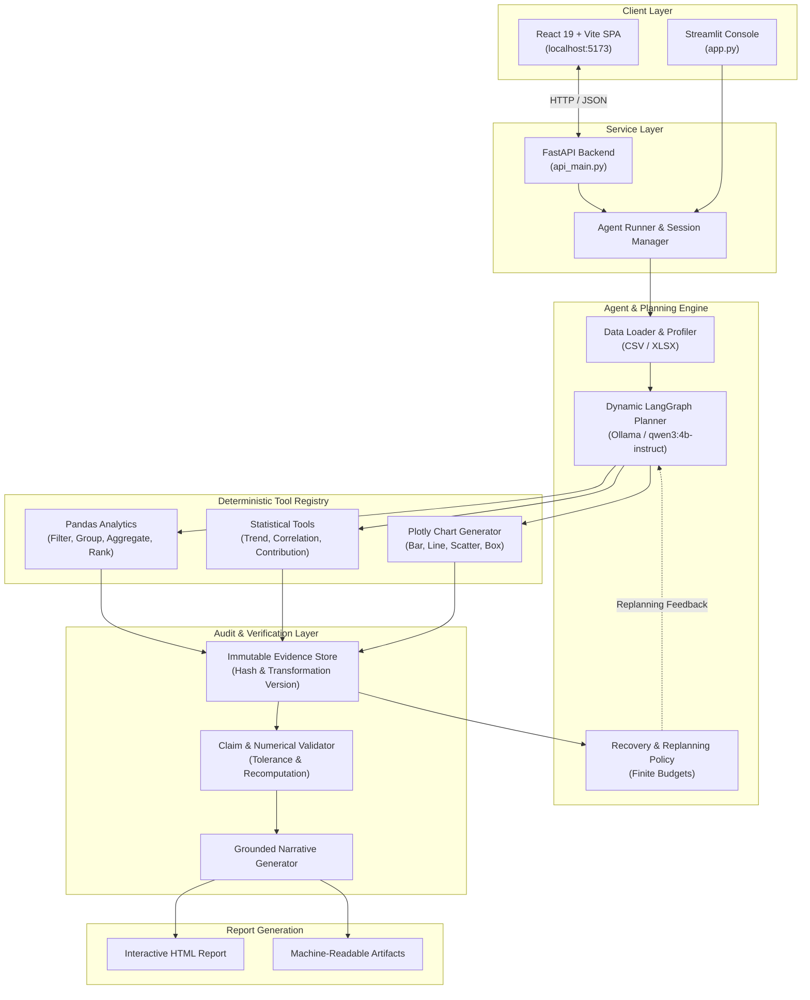
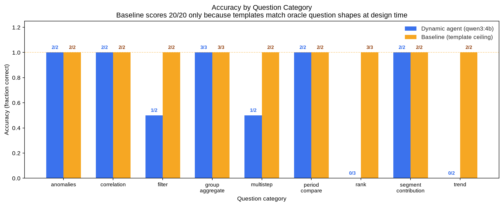

# 📊 Deterministic Dynamic Data Analysis Agent

<p align="center">
  <em>An evidence-grounded, dynamic data analysis agent that plans, verifies, and executes analytical operations with zero arbitrary code execution and strict auditability.</em>
</p>

<p align="center">
  
  <a href="https://www.python.org/downloads/"></a>
  <a href="https://react.dev/"></a>
  <a href="https://fastapi.tiangolo.com/"></a>
  <a href="https://langchain-ai.github.io/langgraph/"></a>
  <a href="https://ollama.com/"></a>
  <a href="https://docs.astral.sh/uv/"></a>
  <a href="#-testing--quality"></a>
</p>

---

## 📌 Table of Contents

- [Overview](#-overview)
- [Key Highlights](#-key-highlights)
- [System Architecture](#-system-architecture)
- [Demo Video](#-demo-video)
- [Analytical Tool Suite](#-analytical-tool-suite)
- [Quick Start](#-quick-start)
  - [Prerequisites](#prerequisites)
  - [1. Backend Setup](#1-backend-setup)
  - [2. Modern React UI Setup](#2-modern-react-ui-setup)
  - [3. Alternative: Streamlit App](#3-alternative-streamlit-app)
- [Configuration Reference](#-configuration-reference)
- [Benchmark & Evaluation](#-benchmark--evaluation)
- [Repository Structure](#-repository-structure)
- [Testing & Quality](#-testing--quality)
- [Multi-Agent Collaboration Protocol](#-multi-agent-collaboration-protocol)
- [License](#-license)

---

## 🌟 Overview

The **Deterministic Dynamic Data Analysis Agent** (`da-agent`) is a production-grade analytical system that transforms natural-language queries into structured analytical workflows over tabular datasets (CSV and XLSX). 

Unlike conventional LLM code-interpreters that execute unchecked Python or SQL in black-box sandboxes, this agent plans and executes analytical tasks exclusively through **pre-defined, deterministic, allowlisted tools**. Every insight, chart, and numerical finding produced links directly to an immutable cryptographic **Evidence Record**, with every reported number verified through strict automated claim validation before rendering.

```
"What was the profit margin trend for Furniture in the West region during 2023?"
                                    │
                                    ▼
       [ Profile Dataset ] ──► [ Plan DAG Tasks ] ──► [ Execute Deterministic Tools ]
                                                              │
                                                              ▼
 [ Verified HTML Report ] ◄── [ Validate Claims ] ◄── [ Store Evidence Records ]
```

---

## ⚡ Key Highlights

- **🔒 Zero Arbitrary Code Execution**: No unconstrained shell commands, Python `eval()`, or raw SQL injection vectors. Analytical primitives are strictly validated through Pydantic contracts and tool specs.
- **🔗 100% Provenance & Claim Validation**: Every numerical claim in findings is cross-checked against recorded runtime evidence within strict tolerances (`rtol: 0.001`, `atol: 0.01`). Ungrounded claims are automatically rejected.
- **🧠 Dynamic LangGraph Re-planning**: When intermediate calculations uncover anomalies, missing columns, or unexpected zero-denominators, the agent dynamically replans and repairs task arguments within budgeted limits.
- **💬 Multi-Turn Conversational Dialogue**: Context-aware dialogue threads (`ChatThread`) maintain historical context and prior analytical steps for progressive drill-downs and iterative investigations.
- **🎨 Modern Dual Interface**:
  - **Modern React 19 + Vite SPA**: Fluid, interactive conversational interface with instant previews, status indicators, and report inspection.
  - **FastAPI Async Backend**: High-performance REST API with session state, file ingestion, and live streaming execution traces.
  - **Streamlit Exploration Console**: Single-command analytical interface for rapid prototyping.
- **🧪 Scientifically Scored Benchmark**: Rigorously evaluated against an independent pandas/numpy oracle on a 20-question frozen benchmark and a 12-scenario recovery test harness.

---

## 🏛️ System Architecture

The pipeline follows a strict layered DAG structure where lower layers never depend on higher layers.



### Architectural Layering & Import Boundaries

To ensure absolute separation of concerns, the repository enforces unidirectional import boundaries checked by unit tests:

| Layer | Package | Permitted Imports |
| :---: | :--- | :--- |
| **L1** | `contracts` | External standard libraries, Pydantic (never imports `da_agent`) |
| **L2** | `core` | `contracts` |
| **L3** | `data` | `contracts`, `core` |
| **L4** | `validation` | `contracts`, `core` |
| **L5** | `tools` | `contracts`, `core`, `data`, `validation` |
| **L6** | `agent`, `reports` | Layers 1–5 (`agent` and `reports` never import each other) |
| **L7** | `pipeline` | Orchestrates all layers (exclusive entry point) |
| **L8** | `api`, `app.py`, `evaluation` | `pipeline`, `contracts`, `core` |

---

## 🎬 Demo Video

A short recorded walkthrough (about 85 seconds) of the app answering questions on the Sample Superstore data: [`docs/demo_video.mp4`](docs/demo_video.mp4).

<video src="docs/demo_video.mp4" controls width="90%"></video>

---

## 🛠️ Analytical Tool Suite

The agent plans workflows using an approved suite of deterministic primitives in `src/da_agent/tools/`:

| Tool | Description |
| :--- | :--- |
| `filter` | Deterministic multi-condition row filter. |
| `group_aggregate` | Group by one or more columns and aggregate a metric. |
| `rank` | Competition ranking of individual rows by a metric, with tie groups. It does not aggregate, so per-entity totals need `group_aggregate` first. |
| `period_compare` | Compare a metric across two date windows (absolute change and growth rate). |
| `trend` | Chronological aggregation by grain with a fitted slope and direction label. |
| `segment_contribution` | Share of a metric contributed by each segment. |
| `correlation` | Pearson correlation between two numeric columns. |
| `detect_anomalies_iqr` | Outlier fences using the 1.5 × IQR rule. |

Plotly chart builders live in `tools/charts.py`. They read recorded tool output and are not planner tools.

---

## 🚀 Quick Start

### Prerequisites

- **Python**: `>= 3.11`
- **uv**: Modern, ultra-fast Python package manager ([installation instructions](https://github.com/astral-sh/uv))
- **Node.js**: `>= 18.0` & **npm** (for the modern React frontend)
- **Ollama**: Running locally with `qwen3:4b-instruct` (or another supported local LLM)

```bash
# Pull the default planner model
ollama pull qwen3:4b-instruct
```

---

### 1. Backend Setup

Clone the repository:

```bash
git clone https://github.com/Despacito64/data-analysis-report-generator.git
cd data-analysis-report-generator
```

Install backend dependencies and sync the virtual environment using `uv`:

```bash
uv sync --all-groups
```

Start the FastAPI backend service:

```bash
uv run uvicorn api_main:app --reload --host 127.0.0.1 --port 8000
```

The API will be available at `http://127.0.0.1:8000` with interactive Swagger docs at `http://127.0.0.1:8000/docs`.

---

### 2. Modern React UI Setup

In a new terminal window:

```bash
cd frontend
npm install
npm run dev
```

Open your browser to: **`http://127.0.0.1:5173`**

- The application automatically connects to the FastAPI backend at `http://127.0.0.1:8000`.
- Click **"Load Sample Superstore"** to test immediately with the bundled benchmark dataset.
- Type any analytical query (e.g., *"Which sub-category in Technology has the highest profit margin?"*) and watch the dynamic execution unfold.

---

### 3. Alternative: Streamlit App

To run the classic standalone Streamlit interface:

```bash
uv run streamlit run app.py
```

Streamlit will launch locally at `http://localhost:8501`.

---

## ⚙️ Configuration Reference

All behavior is centrally managed via [`config.yaml`](config.yaml):

```yaml
# LLM Provider Configuration
model:
  name: "qwen3:4b"                    # Local model via Ollama
  provider: "ollama"                  # Provider backend (ollama, llama.cpp)
  base_url: "http://localhost:11434/v1"
  temperature: 0.0                    # Deterministic greedy decoding
  seed: 42
  answer_narrative_enabled: true     # Grounded natural-language prose synthesis

# Execution and Replanning Budgets
budgets:
  max_llm_calls: 15                   # Maximum LLM planning steps per run
  max_tool_calls: 25                  # Maximum total tool operations
  max_replans: 3                      # Limit on replan cycles
  max_identical_retries: 2            # Prevent retry loops on unrecoverable failures
  per_call_timeout_s: 60.0            # Timeout per individual LLM request

# Dataset Ingestion Constraints
input_limits:
  max_file_size_mb: 50.0
  max_rows: 100000
  allowed_extensions:
    - ".csv"
    - ".xlsx"

# Claim Verification Tolerances
claim_validation:
  rtol: 0.001                         # 0.1% relative tolerance
  atol: 0.01                          # 0.01 absolute tolerance
  rounding_digits: 4
  allow_recomputation: true           # Recompute values independently for audit
  drop_policy: "drop_finding"         # Discard invalid claims rather than hallucinating
```

---

## 📊 Benchmark & Evaluation

The repository includes a scientific evaluation framework comparing the **Dynamic Agent** against a **Fixed-Workflow Baseline** on a frozen test suite scored by an independent pandas/numpy oracle (`evaluation/oracle.py`, answers built by `evaluation/benchmark/build_oracle.py`).

### Verify the Frozen Manifest

Ensure benchmark integrity against the frozen manifest:

```bash
uv run python evaluation/run_frozen_experiment.py --verify-only
```

### Reproduce the Evaluation

Run the evaluation (one run per question, 20 questions; the model is passed explicitly):

```bash
uv run python evaluation/run_agent_eval.py --mode real --repeats 1 --model qwen3:4b-instruct --run-id my-run
```

### Benchmark Results & Ablation Studies

| Experiment Variant | Model | Accuracy | Key Takeaway |
| :--- | :---: | :---: | :--- |
| **Dynamic Agent, replanning on (R1)** | `qwen3:4b-instruct` | **10 / 20 (50%)** | One run per question; 84 LLM calls, 29 min; 0 timeouts. The model kept adding analyses after a correct first result, and the last task is scored |
| **Dynamic Agent, replanning off (R2)** | `qwen3:4b-instruct` | **18 / 20 (90%)** | Same run with `--max-replans 0`; 42 LLM calls, 12 min. Fails q11 and q20 (planning) |
| **Model comparison** | `qwen2.5:7b-instruct`, `llama3.2:3b`, `qwen2.5:3b-instruct` | 8, 2 and 1 of 20 | One run per question, replanning on, same settings as R1 |
| **Fixed Baseline** | Keyed by question id | 20 / 20 (100%) | Ceiling: hard-coded per-question plans, never reads the question text |
| **Recovery suite** | — | **12 / 12 passed** | Mock-only controlled-failure scenarios |

<p align="center">
  
</p>

> For complete stage-time waterfalls, repair distributions, and per-question logs, see [**`docs/EXPERIMENTS_SUMMARY.md`**](docs/EXPERIMENTS_SUMMARY.md).

### Generate Metrics Charts

To re-render all visual charts into `docs/assets/` and `scripts/charts/`:

```bash
uv run python scripts/generate_metrics_charts.py
```

---

## 📁 Repository Structure

```
data-analysis-report-generator/
├── config.yaml                    # System configuration, budgets & tolerances
├── pyproject.toml                 # Package definition & dependency specifications
├── api_main.py                    # Entry point for FastAPI backend
├── app.py                         # Entry point for Streamlit application
│
├── frontend/                      # Modern React 19 + Vite frontend
│   ├── src/
│   │   ├── App.tsx                # Main conversational application component
│   │   ├── api.ts                 # Typed API client for FastAPI backend
│   │   └── styles.css             # Application styling and themes
│   └── package.json
│
├── src/da_agent/                  # Core package
│   ├── agent/                     # LangGraph planning, recovery & dialogue state
│   │   ├── graph.py               # StateGraph definition and workflow transitions
│   │   ├── chat_plan.py           # Conversational plan generation & augmentation
│   │   ├── narrator.py            # Evidence-grounded narrative synthesis
│   │   ├── recovery.py            # Automated error diagnosis and recovery
│   │   └── state.py               # Immutable agent state definitions
│   ├── api/                       # FastAPI router, schemas & runner orchestration
│   ├── contracts/                 # Pydantic data schemas & contracts (v0.2.0)
│   ├── core/                      # Budgets, config loaders, chat thread & trace writer
│   ├── data/                      # File loaders, schema profiler & dataset registry
│   ├── tools/                     # Deterministic analytical & statistical tools
│   ├── validation/                # Argument, result, plan, and claim validators
│   ├── reports/                   # HTML/JSON report generators & Plotly renderers
│   └── pipeline.py                # Public API entry points (run_agent, run_baseline)
│
├── evaluation/                    # Rigorous benchmarking suite
│   ├── benchmark/                 # Frozen questions & manifest
│   ├── oracle.py                  # Loads the frozen expected answers
│   ├── scorer.py                  # Equivalence verification and scoring
│   └── run_frozen_experiment.py   # Benchmark reproduction runner
│
├── scripts/                       # Experiment scripts, presentation builder & chart tools
│   ├── generate_metrics_charts.py # Matplotlib visual chart generator
│   ├── run_experiments.sh         # Reproducible ablation and model spike runner
│
├── docs/                          # Architecture guides, contracts & decision records
│   ├── ARCHITECTURE.md            # Detailed component design & import rules
│   ├── CONTRACTS.md               # Contract model specifications
│   ├── DECISIONS.md               # Architecture Decision Records (ADRs)
│   ├── EXPERIMENTS_SUMMARY.md     # Full empirical results, ablations & model spikes
│   ├── PROGRESS.md                # Milestone tracking & historical session log
│   └── M10_RESULTS.md             # Note on the superseded M10 reference run
│
└── tests/                         # Comprehensive test suite (328 tests)
    ├── unit/                      # Fast unit tests covering all components
    ├── integration/               # Multi-component pipeline tests
    └── fixtures/                  # Synthetic test tables and fixtures
```

---

## 🧪 Testing & Quality

Run the full automated test suite (all 328 tests pass in ~18s):

```bash
uv run pytest
```

Execute code formatting and linting checks:

```bash
uv run ruff check .
```

To run only unit tests for the agent planning engine:

```bash
uv run pytest tests/unit/agent/
```

---

## 🤖 Multi-Agent Collaboration Protocol

This project utilizes a structured asynchronous handoff protocol for human developers and autonomous AI assistants (Claude, Cursor, Antigravity):

- **Shared Context**: [`docs/`](docs/) serves as the persistent memory store across sessions.
- **Rules of Engagement**: See [`AGENTS.md`](AGENTS.md) for strict rules regarding protected files, contract updates, and import hierarchy constraints.
- **Handoffs**: Check [`docs/HANDOFF.md`](docs/HANDOFF.md) at the beginning and end of each session to track open decisions and continuation tasks.

---

## 📄 License

This project is licensed under the [MIT License](LICENSE).

---

<p align="center">
  Built with ❤️ for deterministic, transparent, and verifiable AI data analysis.
</p>
