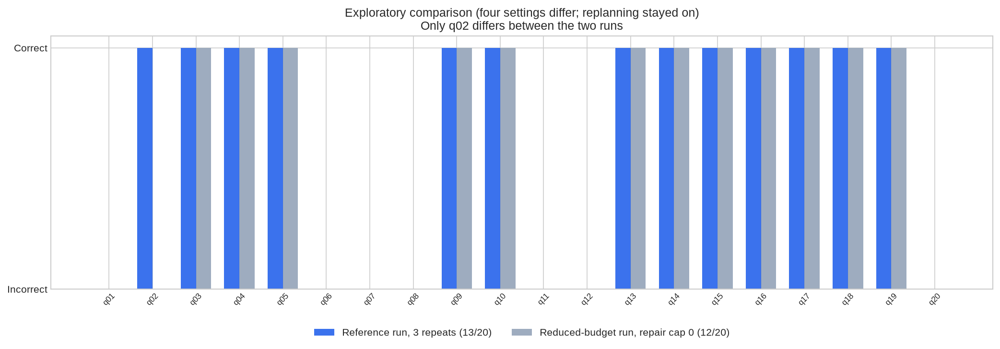
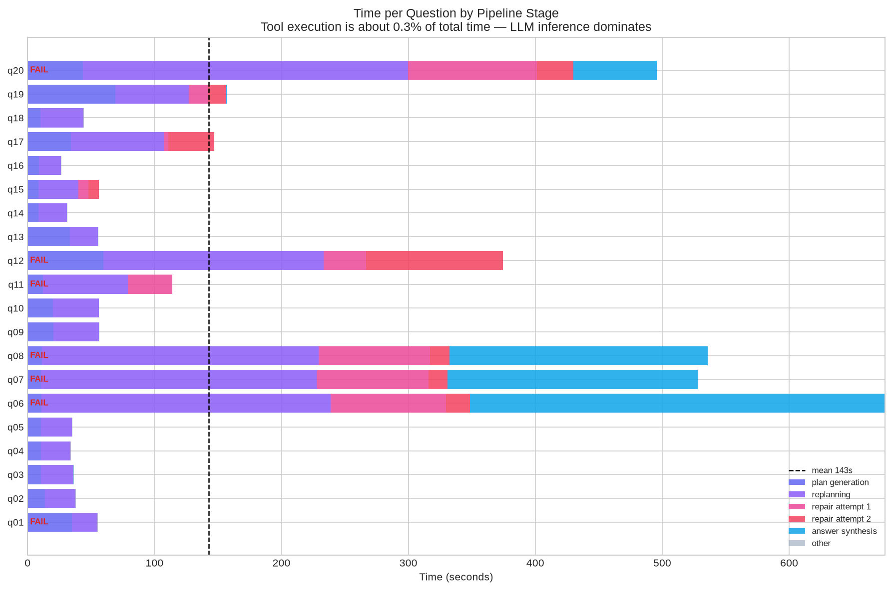
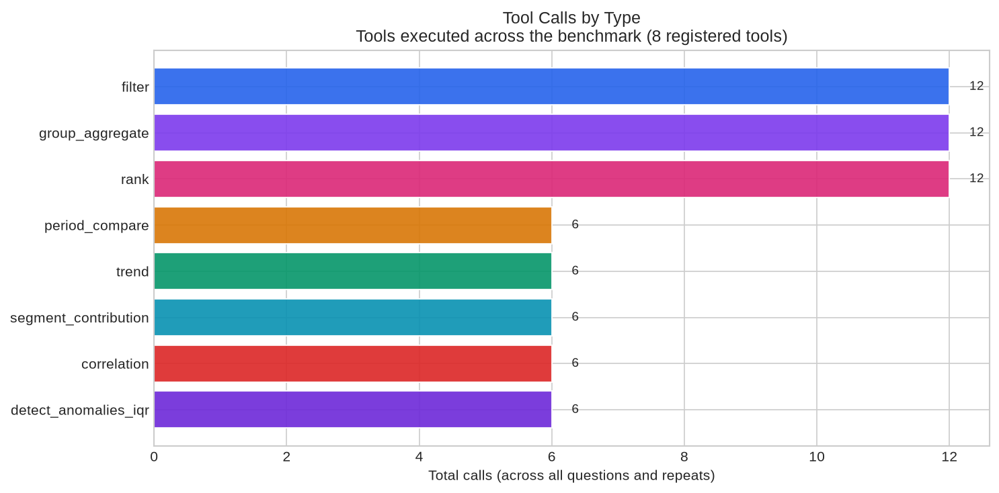
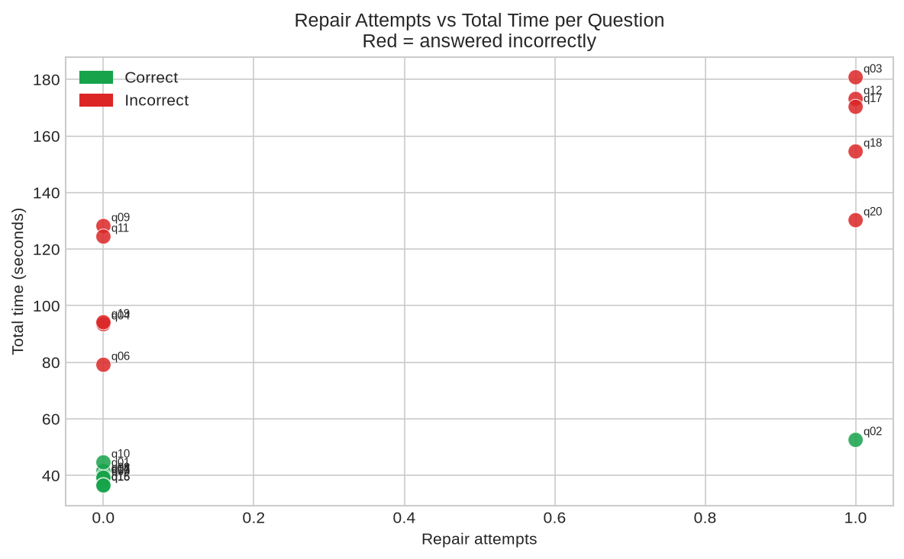

# Experiments Summary

All experiments run on: local machine, GPU GTX 1650, qwen3:4b via Ollama, 2026-11-19.

---

## Experiment 1: M10 Reference Run (main result)

**System:** Dynamic agent, full pipeline (replanning ON, validation ON, narrative ON)  
**Model:** qwen3:4b  
**Questions:** 20 frozen eval questions, 3 repeats each  
**Run ID:** `m10-frozen-real-20261117`

| Metric | Value |
|---|---|
| Correct answers | 13 / 20 |
| Accuracy | 65% |
| Total LLM calls | 168 |
| Total wall time | ~2858 s (~48 min) |
| Timeouts | 0 |
| Failures: incorrect_answer | 6 |
| Failures: no_score_shaped_answer | 1 |

**Per-category breakdown:**

| Category | Correct | Total | Notes |
|---|---|---|---|
| filter | 1 | 2 | q01: plan was `filter` only, which returns a row count; the question needs a sum, so no scoreable answer |
| group_aggregate | 3 | 3 | Perfect |
| rank | 0 | 3 | Planner chose a correct-looking single `rank` task, but `rank` ranks individual rows (no aggregation argument), so it returned top single transactions, not per-entity totals |
| period_compare | 2 | 2 | Perfect |
| trend | 0 | 2 | q11: plan had no 2017 restriction, so the trend covered 2014-2017. q12: numbers and slope match the oracle exactly; only the direction label differs (tool `volatile`, oracle `increasing`) |
| segment_contribution | 2 | 2 | Perfect |
| correlation | 2 | 2 | Perfect |
| anomalies | 2 | 2 | Perfect |
| multistep | 1 | 2 | q19 passed (`filter` then `group_aggregate`); q20 failed (after the Consumer filter, a `rank` of individual rows instead of per-city totals) |

**Stage time breakdown (aggregate across all questions, from `agent_eval.md`):**

| Stage | Total time (s) | Share of 2858 s |
|---|---|---|
| replanning | 1609 | 56% |
| answer_synthesis | 794 | 28% |
| plan_generation | 440 | 15% |
| repair_attempt_1 + 2 | 706 | 25% (overlaps the plan and replan stages) |
| tool_execution | 10 | 0.3% |

The shares overlap, so they do not sum to 100%. Individual tool calls took 0.003 s to about 1 s (the `rank` calls were the slowest). LLM inference accounts for nearly all of the wall time.

**Replanning is noisy with a 4B model.** In the q06 and q07 traces the result-inspection LLM call returned invalid plans (for example an unknown tool `text`, or a `trend` task with its required arguments missing), which the validator rejected. That is where much of the replanning time went.

**Failure diagnosis (verified from the saved traces):** in all seven failures the tool status was `ok`. The wrong answers came from the plan, not from answer extraction: `rank` has no aggregation argument (q06-q08, q20), q11 and q01 had incomplete plans, and q12 is a label disagreement between the tool and the oracle.

**Baseline note:** the baseline is keyed by question id (`BASELINE_TASKS["q01"]...` in `baseline.py`) and never reads the question text. Its answers for q01, q06-q08 and q20 are also assembled by hand-written per-question code. It is a ceiling, not a competitor, and it cannot answer a question outside the 20.

---

## Experiment 2: Reduced-budget run with the plan-repair cap set to 0 (exploratory)

> **Correction (2026-11-19).** This run was first labelled "No Replanning". That label was wrong. `max_repair_attempts` only caps the planner's re-prompt loop after an invalid plan (`planner.py:397`, `for attempt in range(max_repairs + 1)`). Result-driven replanning is governed by `max_replans` (3, unchanged), and it still ran: the q02 trace shows a replan adding a task. A true no-replan ablation (`max_replans=0`) has not been run.

**What differed from the reference run (four settings at once):**

| Setting | Reference | This run |
|---|---|---|
| `max_repair_attempts` | 2 | 0 |
| `max_llm_calls_per_question` | 8 | 4 |
| `per_question_budget_s` | 300 | 180 |
| repeats | 3 | 1 |

**Run ID:** `ablation-no-replan-20261119150629` (name kept for traceability)

| Metric | Reference | This run |
|---|---|---|
| Correct | 13 / 20 | 12 / 20 |
| Accuracy | 65% | 60% |

**Only q02 differs between the two runs.** The reference passed q02 in all 3 repeats. In the reduced-budget run the plan was the same `filter`, but `augment_chat_plan` (added for the chat interface in D-048) appended a `group_aggregate` to the filter-only plan, so the scorer took `{'West': 251991.83}` as the answer instead of the count 599. This is a plan-augmentation effect, not a replan effect. It is present in all final-code runs (see R1 below).

**Interpretation.** With n = 1, one question and four confounded settings, this run cannot show that replanning helps or hurts. What it does show is that, with a 4B model, result-driven replanning can add unnecessary tasks and change a correct answer. A clean test needs one variable at a time (`max_replans=0`) with 3 repeats.

---

## Experiment 3: Model Comparison Spike

**Scope:** 5 questions chosen to span categories: q03 (group_aggregate), q06 (rank), q09 (period_compare), q13 (segment_contribution), q17 (anomalies).  
**1 repeat each, run under the same reduced settings as Experiment 2 (180 s per question).** Both new runs stopped after these 5 (15 of 20 not run), and the qwen3:4b column is taken from the 3-repeat reference run, so the columns are not like-for-like.

| Model | Params | Passed (of the 5) | Avg time/q | What was recorded |
|---|---|---|---|---|
| qwen2.5:3b-instruct | 3B | 0 | ~85 s | q03, q17 `no_score_shaped_answer`; q09, q13 `repair_cap`; q06 timeout |
| qwen3:4b (reference run) | 4B | 4 | ~165 s | only q06 failed |
| qwen2.5:7b-instruct | 7B | 2 | ~90 s | q03, q13 passed; q09, q17 `no_score_shaped_answer`; q06 timeout |

**What can be said.** Five questions, one repeat and different run settings are not enough to rank the models. The recorded failure types are informative: the 3B model hit the repair cap (its plans failed validation) on two questions, and the 7B model returned answers the scorer could not shape on two. Why the 7B model did worse than qwen3:4b has not been investigated, so no claim about model families is made here.

---

## Summary Table

| Experiment | Variant | Score | What it shows |
|---|---|---|---|
| M10 reference | qwen3:4b, full system | 13/20 (65%) | Main result |
| Exploratory run | repair cap 0, reduced budgets, 1 repeat | 12/20 (60%) | Not a no-replan ablation; four settings changed; only q02 differs |
| Model spike (partial) | qwen2.5:3b-instruct | 0 of 5 run | 2 repair-cap failures, 2 unshaped answers, 1 timeout |
| Model spike (partial) | qwen3:4b (reference run) | 4 of the same 5 | From the 3-repeat reference run |
| Model spike (partial) | qwen2.5:7b-instruct | 2 of 5 run | 2 unshaped answers, 1 timeout |
| Recovery suite | 12 scenarios | 12/12 | Mock-only failure-recovery scenarios |
| Baseline | Keyed by question id | 20/20 | Ceiling, not a competitor |

---

## Charts & Visualizations

All charts are saved in both `docs/assets/` and `evaluation/results/charts/` (and generated via `scripts/charts/`).

### 1. Accuracy by Category

### 2. Exploratory comparison: reference run vs reduced-budget run (repair cap 0)

### 3. Partial 5-question model spike (3B, 4B, 7B)

### 4. Stage Time Waterfall

### 5. LLM Call Distribution

### 6. Tool Distribution

### 7. Repair Attempts vs Total Time

| File | Content |
|---|---|
| `docs/assets/chart_accuracy_by_category.png` | Agent vs baseline by question category |
| `docs/assets/chart_stage_time_waterfall.png` | Time per question broken down by pipeline stage |
| `docs/assets/chart_llm_calls_distribution.png` | LLM calls per question (red = failed) |
| `docs/assets/chart_tool_distribution.png` | Which tools were called and how often |
| `docs/assets/chart_repair_impact.png` | Repair attempts vs total time scatter |
| `docs/assets/chart_ablation_comparison.png` | With vs without replanning per question |
| `docs/assets/chart_model_comparison.png` | 3B vs 4B vs 7B on 5 spike questions |
| `docs/assets/summary_table.csv` | Full per-question data table |

