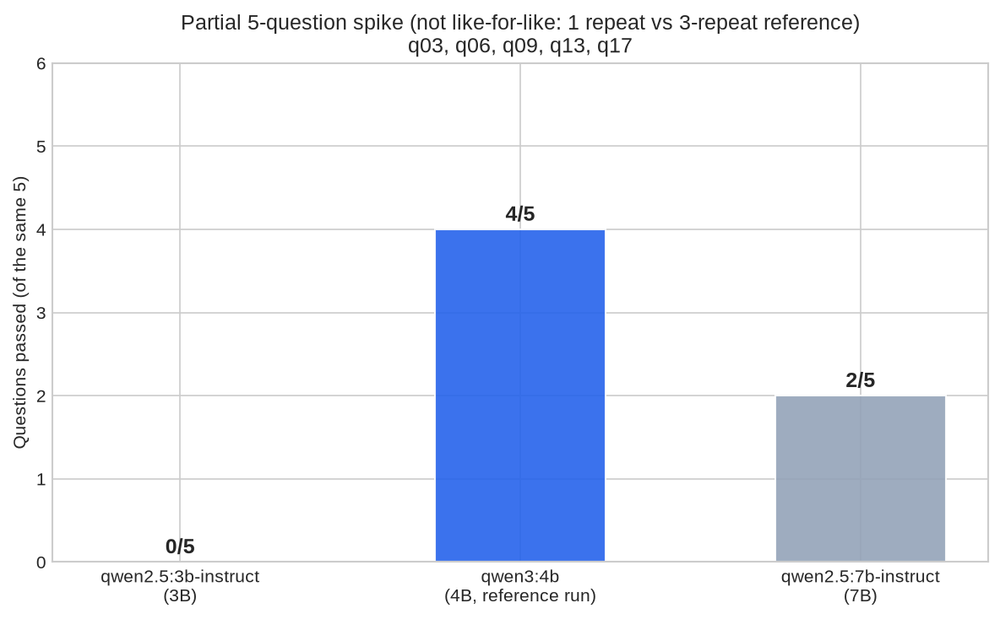
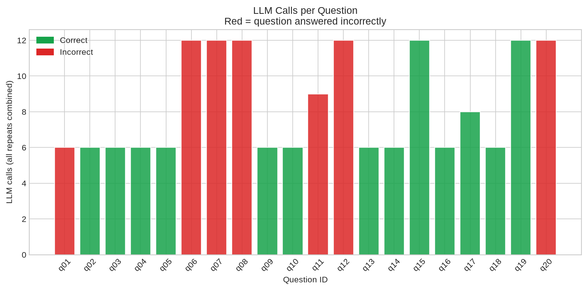

# Experiments Summary

## Current results (2026-11-20): post-freeze-fixes code, `qwen3:4b-instruct`, one run per question

All runs: GTX 1650 (4 GB), Ollama 0.23.3, temperature 0, seed 42, 60 s per call, 300 s per question, 8 LLM calls per question. The model is passed with `--model qwen3:4b-instruct`; `config.yaml` and the freeze manifest still name `qwen3:4b` and were not edited. The question file, oracle and configuration hashes match the freeze manifest.

**Important:** the system was changed after an earlier run on the same questions (tool changes in commit `1703cf7`), and the planner model was replaced after the freeze. These results are not a held-out measurement.

| Run | Run id | Passed | LLM calls | Minutes | Failed questions |
|---|---|---|---|---|---|
| R1: replanning on | `post-freeze-fixes-frozen-real-20261120` | 10 / 20 | 84 | 29 | q03, q04, q06, q09, q11, q12, q17, q18, q19, q20 |
| R2: replanning off (`--max-replans 0`) | `post-freeze-fixes-no-replan-20261120` | 18 / 20 | 42 | 12 | q11, q20 |
| qwen2.5:7b-instruct | `spike-fixed-qwen25-7b-20261120` | 8 / 20 | 47 | | |
| llama3.2:3b | `spike-fixed-llama32-3b-20261120` | 2 / 20 | 92 | | |
| qwen2.5:3b-instruct | `spike-fixed-qwen25-3b-20261120` | 1 / 20 | 93 | | |

The model comparison used replanning on. Recovery suite: 12 / 12 pass (model-free, run separately). Model-free ceiling check on the fixed code: a passing plan exists for 20 of 20 questions (`docs/report/generated/ceiling_check_fixed.json`).

**Why replanning lowered the score (from traces, `docs/report/generated/rerun_failure_causes.md`):** the first plan has the same tool list in both runs for all 20 questions. In eight questions (q03, q04, q06, q09, q12, q17, q18, q19) the inspection step added tasks after a correct first result in R1, and the scorer, which reads the last executed task, took an added analysis as the answer. q11 (no 2017 restriction in the plan) and q20 (`rank` without `aggregation` after a `group_aggregate`) fail in both runs. This is one model with one prompt; it is not a general claim about replanning.

Per-question data: `docs/report/generated/rerun_outcomes.csv`; numbers: `docs/report/generated/rerun_numbers.json`.

---

# Earlier experiments (previous model `qwen3:4b`, superseded)

The sections below describe runs made before the code fixes and the model replacement. They are kept as a record. Do not quote their numbers as current results.

All experiments run on: local machine, GPU GTX 1650, qwen3:4b via Ollama, 2026-11-19.

---

## Experiment 1: M10 Reference Run (main result)

**System:** Dynamic agent, full pipeline (replanning ON, validation ON, narrative ON)  
**Model:** qwen3:4b  
**Questions:** 20 frozen eval questions, 3 repeats each  
**Run ID:** `m10-frozen-real-20261117`

| Metric | Value |
|---|---|
| Correct answers | 13 / 20 |
| Accuracy | 65% |
| Total LLM calls | 168 |
| Total wall time | ~2858 s (~48 min) |
| Timeouts | 0 |
| Failures: incorrect_answer | 6 |
| Failures: no_score_shaped_answer | 1 |

**Per-category breakdown:**

| Category | Correct | Total | Notes |
|---|---|---|---|
| filter | 1 | 2 | q01: plan was `filter` only, which returns a row count; the question needs a sum, so no scoreable answer |
| group_aggregate | 3 | 3 | Perfect |
| rank | 0 | 3 | Planner chose a correct-looking single `rank` task, but `rank` ranks individual rows (no aggregation argument), so it returned top single transactions, not per-entity totals |
| period_compare | 2 | 2 | Perfect |
| trend | 0 | 2 | q11: plan had no 2017 restriction, so the trend covered 2014-2017. q12: numbers and slope match the oracle exactly; only the direction label differs (tool `volatile`, oracle `increasing`) |
| segment_contribution | 2 | 2 | Perfect |
| correlation | 2 | 2 | Perfect |
| anomalies | 2 | 2 | Perfect |
| multistep | 1 | 2 | q19 passed (`filter` then `group_aggregate`); q20 failed (after the Consumer filter, a `rank` of individual rows instead of per-city totals) |

**Stage time breakdown (aggregate across all questions, from `agent_eval.md`):**

| Stage | Total time (s) | Share of 2858 s |
|---|---|---|
| replanning | 1609 | 56% |
| answer_synthesis | 794 | 28% |
| plan_generation | 440 | 15% |
| repair_attempt_1 + 2 | 706 | 25% (overlaps the plan and replan stages) |
| tool_execution | 10 | 0.3% |

The shares overlap, so they do not sum to 100%. Individual tool calls took 0.003 s to about 1 s (the `rank` calls were the slowest). LLM inference accounts for nearly all of the wall time.

**Replanning is noisy with a 4B model.** In the q06 and q07 traces the result-inspection LLM call returned invalid plans (for example an unknown tool `text`, or a `trend` task with its required arguments missing), which the validator rejected. That is where much of the replanning time went.

**Failure diagnosis (verified from the saved traces):** in all seven failures the tool status was `ok`. The wrong answers came from the plan, not from answer extraction: `rank` has no aggregation argument (q06-q08, q20), q11 and q01 had incomplete plans, and q12 is a label disagreement between the tool and the oracle.

**Baseline note:** the baseline is keyed by question id (`BASELINE_TASKS["q01"]...` in `baseline.py`) and never reads the question text. Its answers for q01, q06-q08 and q20 are also assembled by hand-written per-question code. It is a ceiling, not a competitor, and it cannot answer a question outside the 20.

---

## Summary Table (earlier experiments)

| Experiment | Variant | Score | What it shows |
|---|---|---|---|
| M10 reference | previous qwen3:4b, full system | 13/20 (65%) | Earlier main result (3 repeats), kept as the milestone record |
| Recovery suite | 12 scenarios | 12/12 | Mock-only failure-recovery scenarios |
| Baseline | Keyed by question id | 20/20 | Ceiling, not a competitor |

The other earlier runs (a reduced-budget run, a clean ablation on the previous code and two partial model spikes) were removed on 2026-11-20 at the owner's request; they can be restored from git history (tag `pre-cleanup-20261120`).

---

## Charts & Visualizations

All charts are saved in both `docs/assets/` and `evaluation/results/charts/` (and generated via `scripts/charts/`).

### 1. Accuracy by Category

### 2. Replanning on versus off, per question (R1 and R2)

### 3. Four local models, one run per question (replanning on)

### 4. Stage Time Waterfall

### 5. LLM Call Distribution

### 6. Tool Distribution

### 7. Repair Attempts vs Total Time

| File | Content |
|---|---|
| `docs/assets/chart_accuracy_by_category.png` | Agent vs baseline by question category |
| `docs/assets/chart_stage_time_waterfall.png` | Time per question broken down by pipeline stage |
| `docs/assets/chart_llm_calls_distribution.png` | LLM calls per question (red = failed) |
| `docs/assets/chart_tool_distribution.png` | Which tools were called and how often |
| `docs/assets/chart_repair_impact.png` | Repair attempts vs total time scatter |
| `docs/assets/chart_ablation_comparison.png` | With vs without replanning per question |
| `docs/assets/chart_model_comparison.png` | 3B vs 4B vs 7B on 5 spike questions |
| `docs/assets/summary_table.csv` | Full per-question data table |

