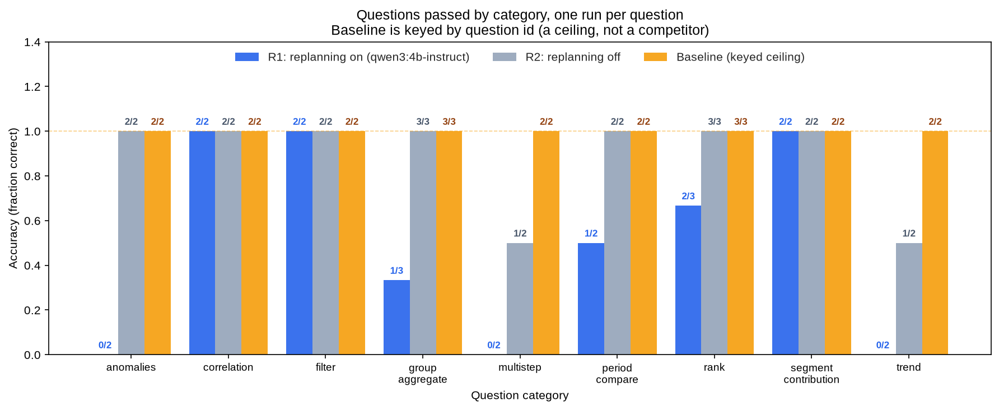

# Experiments Summary

## Current results (2026-11-20): post-freeze-fixes code, `qwen3:4b-instruct`, one run per question

All runs: GTX 1650 (4 GB), Ollama 0.23.3, temperature 0, seed 42, 60 s per call, 300 s per question, 8 LLM calls per question. The model is passed with `--model qwen3:4b-instruct`; `config.yaml` and the freeze manifest still name `qwen3:4b` and were not edited. The question file, oracle and configuration hashes match the freeze manifest.

| Run | Run id | Passed | LLM calls | Minutes | Failed questions |
|---|---|---|---|---|---|
| R1: replanning on | `post-freeze-fixes-frozen-real-20261120` | 10 / 20 | 84 | 29 | q03, q04, q06, q09, q11, q12, q17, q18, q19, q20 |
| R2: replanning off (`--max-replans 0`) | `post-freeze-fixes-no-replan-20261120` | 18 / 20 | 42 | 12 | q11, q20 |
| qwen2.5:7b-instruct | `spike-fixed-qwen25-7b-20261120` | 8 / 20 | 47 | | |
| llama3.2:3b | `spike-fixed-llama32-3b-20261120` | 2 / 20 | 92 | | |
| qwen2.5:3b-instruct | `spike-fixed-qwen25-3b-20261120` | 1 / 20 | 93 | | |

The model comparison used replanning on. Recovery suite: 12 / 12 pass (model-free, run separately). Model-free ceiling check on the fixed code: a passing plan exists for 20 of 20 questions (`docs/report/generated/ceiling_check_fixed.json`).

**Why replanning lowered the score (from traces, `docs/report/generated/rerun_failure_causes.md`):** the first plan has the same tool list in both runs for all 20 questions. In eight questions (q03, q04, q06, q09, q12, q17, q18, q19) the inspection step added tasks after a correct first result in R1, and the scorer, which reads the last executed task, took an added analysis as the answer. q11 (no 2017 restriction in the plan) and q20 (`rank` without `aggregation` after a `group_aggregate`) fail in both runs. This is one model with one prompt; it is not a general claim about replanning.

Per-question data: `docs/report/generated/rerun_outcomes.csv`; numbers: `docs/report/generated/rerun_numbers.json`.

---

The earlier runs (the 2026-11-17 milestone reference run and the later exploratory runs, all made with the previous model and code) were removed on 2026-11-20. They remain in git history (local tag `pre-cleanup2-20261120`) and are not used for any current result.

---

## Charts & Visualizations

All charts are saved in both `docs/assets/` and `evaluation/results/charts/` (and generated via `scripts/charts/`).

### 1. Accuracy by Category

### 2. Replanning on versus off, per question (R1 and R2)

### 3. Four local models, one run per question (replanning on)

### 4. Stage Time Waterfall

### 5. LLM Call Distribution

### 6. Tool Distribution

### 7. Repair Attempts vs Total Time

| File | Content |
|---|---|
| `docs/assets/chart_accuracy_by_category.png` | Agent vs baseline by question category |
| `docs/assets/chart_stage_time_waterfall.png` | Time per question broken down by pipeline stage |
| `docs/assets/chart_llm_calls_distribution.png` | LLM calls per question (red = failed) |
| `docs/assets/chart_tool_distribution.png` | Which tools were called and how often |
| `docs/assets/chart_repair_impact.png` | Repair attempts vs total time scatter |
| `docs/assets/chart_ablation_comparison.png` | With vs without replanning per question |
| `docs/assets/chart_model_comparison.png` | 3B vs 4B vs 7B on 5 spike questions |
| `docs/assets/summary_table.csv` | Full per-question data table |

