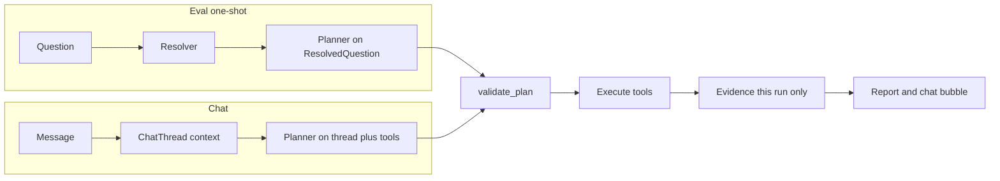

# Chat interpreter design: model-planned tools on a conversation thread

**Status:** Proposed — implementation after owner approval  
**Date:** 2026-11-19  
**Supersedes (for chat UI only):** symbolic-only follow-up via `resolve_question(..., dialogue=...)` as the sole interpreter  
**Does not change (until a new decision):** frozen 20-question eval, baseline templates, oracle, Streamlit evidence pre-seed

---

## 1. Problem

Live testing showed conversational follow-ups fail in ways common chat products handle easily:

- **"tell me more about furniture"** — declined because the deterministic resolver does not map a **member value** (`Furniture`) to a **filter** on the prior grouping column (`Category`).
- **"what about furniture category"** — partially merged with dialogue, but the planner chose a different metric (`Quantity` mean) and returned all categories instead of drilling into `Furniture`.

Industry-style agents ([LangChain pandas agent](https://github.com/langchain-ai/langchain-experimental), [DataAgent-Pro](https://github.com/ChetanVK10/DataAgent-Pro), Vercel AI SDK tool-calling demos) do **not** front every turn with a regex resolver. They send **chat history + schema + tools** to the model; the model proposes tool calls; **code executes and validates**.

This repository still requires:

- One agent, allowlisted tools only, no arbitrary Python/SQL from the LLM.
- Numbers in the UI/report only via **this turn’s** valid `EvidenceRecord`s.
- Oracle independence and frozen eval reproducibility.

The design below adds a **chat interpreter path** that matches competitor UX while keeping eval on the current resolver-first pipeline.

---

## 2. Goals and non-goals

### Goals

1. Follow-ups such as drill-ins (`Furniture`), metric changes, and new groupings work when the model can see prior turns and tool **labels** (not copied evidence).
2. Every executed task still passes existing **argument**, **result**, and **claim** validation.
3. Frozen benchmark `run_agent(question)` without thread context remains the M10 comparison path.
4. Fix UX bugs found in the recording: report link on empty runs, decimal mismatch, misleading “Your file” empty state (documented in §8).

### Non-goals

- LLM-written SQL or sandboxed arbitrary pandas strings (out of scope per `PROJECT_SCOPE.md`).
- Multi-agent supervisors or new tools beyond the current registry.
- Re-scoring M10 or rewriting frozen questions until owner accepts a new reference run.
- Streaming tokens in the first slice (polling stays).

---

## 3. Two entry modes (same tools, different interpreter)

| Mode | Caller | Question interpretation | Memory |
| --- | --- | --- | --- |
| **Eval / one-shot** | `evaluation/`, `pipeline.run_agent` without thread | `resolve_question(question, profile)` → `ResolvedQuestion` → `generate_plan(resolved, ...)` | None |
| **Chat** | React API `POST .../runs` | `build_chat_context(session)` → planner messages include thread + profile + `ToolSpec`s → LLM emits **Plan** JSON → `validate_plan` | `ChatThread` on session |

**Rule:** Chat runs never call `seed_reused_evidence`. Dialogue cards (`DialogueState`) may remain as an **audit log** after each turn, but they are **not** the primary interpreter on the chat path.

---

## 4. Chat thread contract (proposed)

Add `ChatTurn` / `ChatThread` (API session layer first; optional later promotion to `contracts` if Streamlit adopts it).

| Field | Stored? | In planner prompt? |
| --- | --- | --- |
| `role` | user / assistant | Yes |
| `text` | Message body | Yes |
| `run_id` | Yes | No (internal) |
| `intent_summary` | Optional one line from resolve or plan | Yes (assistant turns) |
| `group_labels` | Category names from last table (e.g. Furniture) | Yes, labels only |
| `decline_reason` | If unanswerable | Yes |
| `evidence_ids` | On disk in trace | **No** |
| `amounts` | In evidence store | **No** |

**Dataset change:** new `dataset_hash` clears `ChatThread` (same rule as dialogue today).

**Oracle / eval leakage:** Frozen question text and expected answers never appear in chat prompts. Eval harness never passes `ChatThread`.

---

## 5. Chat planner behavior

### 5.1 Inputs

System prompt (existing `build_system_prompt`): column list, semantic types, budgets, registered tools.

User-side context block (new builder in `da_agent/agent/` or `da_agent/ui/`):

1. Dataset: `source_name`, `row_count`, `dataset_hash` (hash optional in prompt).
2. **Thread:** last *N* turns (config, default 6 messages), user text + assistant summary.
3. **Drill-in hint:** if the last assistant turn listed `group_labels`, instruct the model that unqualified nouns matching those labels should become **filters** on the corresponding column, keeping the previous metric unless the user names a new one.
4. Current user message.

The model output format stays the existing **typed Plan** JSON (M5/M6), not free-form SQL.

### 5.2 Resolve node on chat path

**Option A (recommended):** Skip `node_resolve` for chat runs, or make resolve a no-op that only logs “chat mode.” Planning reads the thread directly.

**Option B:** Keep resolve as a **post-plan** check: after the model proposes tasks, derive a `ResolvedQuestion` from the first task’s args for logging and `DialogueTurn` append — not as a gate.

Do **not** block the graph on `resolve_question` regex when `chat_thread` is present.

### 5.3 Validation as the real “resolver”

Competitors rely on execution; we rely on **existing layers**:

| Check | Enforces |
| --- | --- |
| `validate_plan` | Known tools, acyclic DAG, one ready task |
| `validate_task_args` | Columns exist, types, periods in coverage |
| Tool invariants | Sum contributions, non-empty filters, etc. |
| `validate_findings` | Answer text matches evidence |

**New chat-specific check (small):** optional `assert_plan_matches_thread_hints(plan, thread)` — if the user message matches a known `group_label` from the previous turn, the first analytical task must include an `eq` filter on that column **or** the plan must document a deliberate full breakdown in `rationale`. Failure → `invalid_args` → bounded replan (existing M6 loop).

This is softer than regex resolve but stricter than “trust the 4B model.”

### 5.4 Member-value matching (deterministic helper, not a full resolver)

Pure function `suggest_filters_from_message(text, profile, prior_labels) -> list[FilterSpec]`:

- Match tokens to `ColumnProfile.examples` and known enum-like values (Region, Category, Segment) case-insensitively.
- Expose matches in the **planner prompt** as hints: “Prior result mentioned labels: …; candidate filters: Category=Furniture.”

The model may ignore hints; validators and replan recover. This replaces expanding `_REFINEMENT` regex lists.

---

## 6. End-to-end chat run (API)

1. Client sends `question` on existing session.
2. `start_run` appends user turn to `ChatThread` (text only).
3. `run_agent(..., chat_thread=..., dialogue=None)` or a dedicated `run_chat_agent(...)` in `pipeline.py` that sets a flag on `AgentState`.
4. Graph: plan → execute → inspect → finalize (unchanged control graph).
5. On complete: append assistant turn with `summary`, `group_labels` extracted from presenter output (not raw evidence JSON).
6. Client polls; render table from API view; show report link only if numeric claims exist (§8).

---

## 7. Relationship to `DialogueState` (D-046)

| Artifact | Chat path role after this design |
| --- | --- |
| `DialogueState` | Optional audit trail (metric, grouping, filters) after run; may be derived from executed task args, not from regex resolve |
| `DialogueTurn` | Keep for hash-gate tests; populate from **validated args**, not from pre-run resolve |

Frozen eval does not use either.

---

## 8. UI and API fixes (same release or immediately before)

| Issue | Fix |
| --- | --- |
| Report link on declined turn | `report_ready = report.html exists AND (summary or table_rows or numeric claims count > 0)` |
| 2 vs 3 decimals | Format chat table amounts with same rule as `presenters.py` (`:,.2f`) |
| “Your file” clears sample in UI | Keep `session` until upload completes; **Your file** only reveals upload; toggling back to sample restores demo without clearing server session until explicit upload |

---

## 9. Streamlit

Out of scope for slice 1 unless owner requests parity. Streamlit can keep `reused_evidence` + resolver until a follow-up decision (D-043 remains for that path).

---

## 10. Testing strategy

Write tests **before** switching the chat API:

1. **Planner prompt fixture:** chat thread with prior “sales by category” + user “tell me more about furniture” → prompt contains `Furniture` hint and does not contain prior dollar amounts.
2. **Plan validation:** mock plan with `group_aggregate` + filter `Category=Furniture` passes; mock plan with wrong metric after drill-in hint triggers replan or failure class.
3. **Graph mode flag:** `chat_thread` set → initial `resolved` may be null; graph still reaches execute.
4. **Eval regression:** `run_agent("What are total sales by category?", dialogue=None, chat_thread=None)` still uses resolver path (golden `ResolvedQuestion` fields unchanged).
5. **API:** declined run → `report_ready` false; successful run → true.
6. **Member matcher unit tests** for Superstore examples.

---

## 11. Implementation phases

| Phase | Deliverable | Risk |
| --- | --- | --- |
| **0** | UI/API fixes §8 | Low |
| **1** | `ChatThread` on session, prompt builder, skip resolve gate for chat | Medium — prompt size |
| **2** | `suggest_filters_from_message` hints + optional plan-thread assert | Low |
| **3** | Remove reliance on `_REFINEMENT` for API; derive dialogue card post-run | Low |
| **4** | Owner decision: Streamlit chat mode or leave as-is | Product |

**Contract version:** No bump unless `ChatThread` moves into `contracts/models.py`. If it does, owner approval + `DECISIONS.md` + bump `0.2.0` → `0.2.1` or `0.3.0`.

**Proposed decision id:** D-047 (to be appended when approved).

---

## 12. Open questions for owner

1. Max thread messages in prompt (6 vs full history with summarization).
2. Whether failed plans should ask the user a clarifying question (LangGraph `interrupt`) vs decline with reason (current style).
3. Whether slice 1 should switch chat to **single-task plans only** (faster 4B) or keep multi-step for “compare then rank” questions.

---

## 13. Summary

**Competitors:** conversation + schema + tools → model chooses args → code runs.  
**Us today (chat):** regex resolver → model plans from `ResolvedQuestion` → brittle follow-ups.  
**Us next (chat):** conversation + schema + tools → model plans → **validators** → code runs; resolver stays for **eval only**.

This preserves evidence-backed reports and frozen benchmarks while making the React agent behave like the products users compare us to.